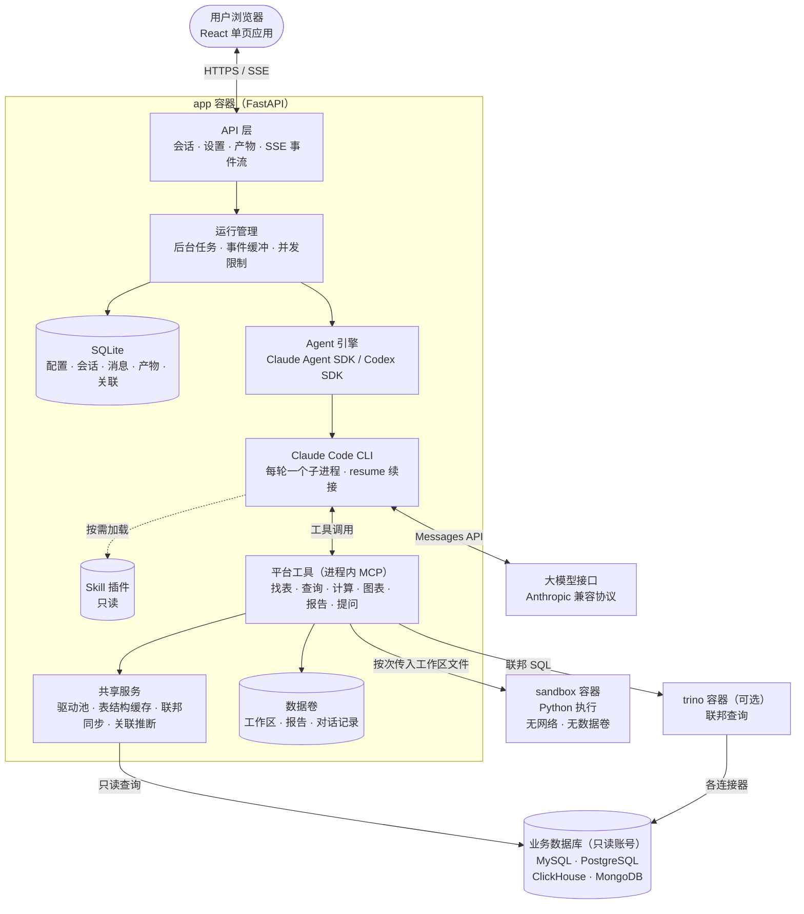
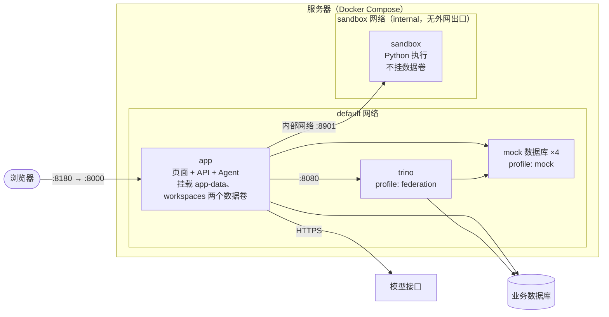
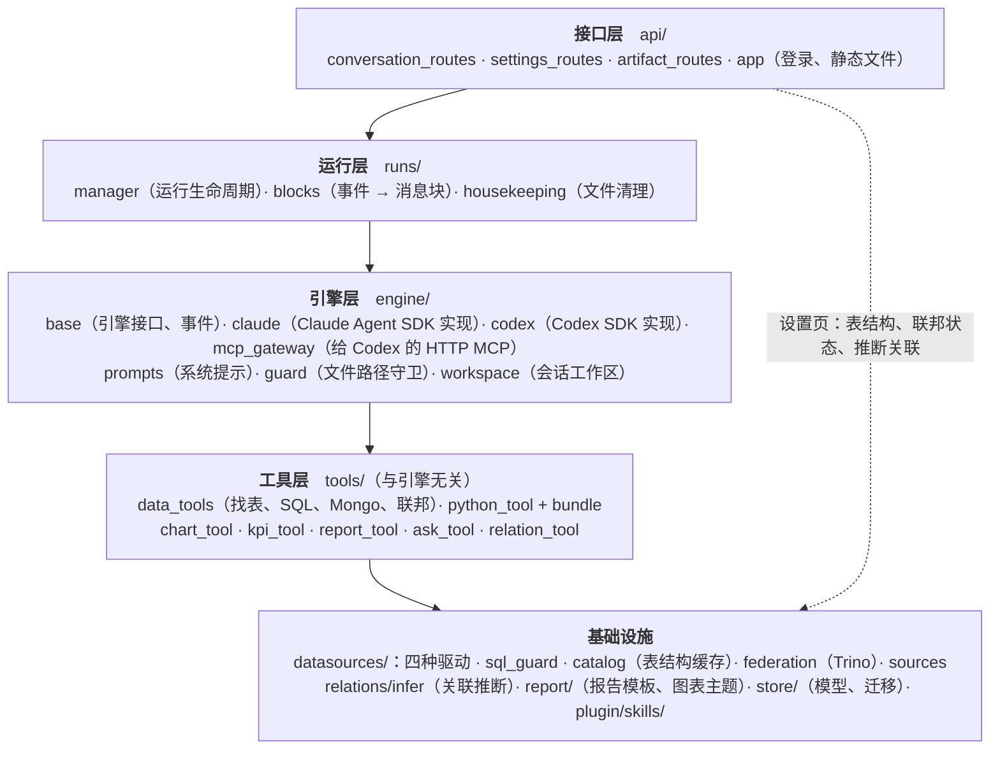
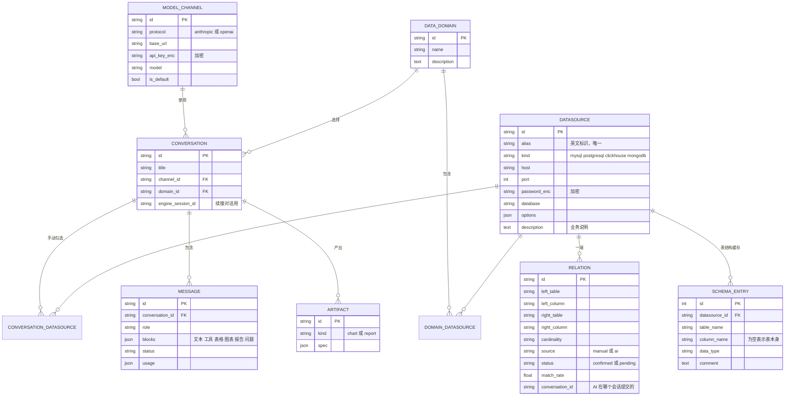
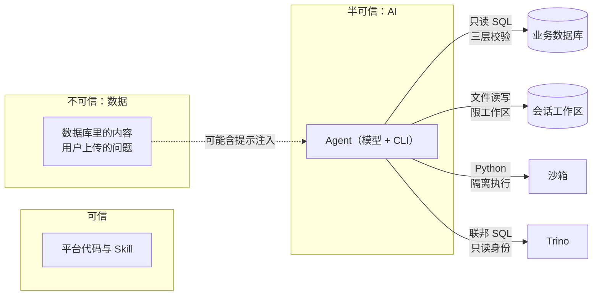

# 系统架构设计

## 1. 总体架构

| 组件 | 职责 | 技术 |
|---|---|---|
| 前端 | 对话界面、设置页、图表与报告展示 | React 19、Vite、Tailwind 4、ECharts 5、TanStack Query |
| API 层 | REST 接口、SSE 事件流、访问口令校验、托管前端静态文件 | FastAPI、sse-starlette |
| 运行管理 | 把一轮对话放到后台任务里跑，与 HTTP 连接解耦；缓冲事件供断线重放；全局并发上限 | asyncio |
| Agent 引擎 | 组装系统提示、工具、权限，驱动模型多轮调用工具 | Anthropic 协议：Claude Agent SDK（内置 Claude Code CLI）；OpenAI 协议：Codex Python SDK（内置 codex app-server，走 Responses API） |
| 平台工具 | AI 能做的所有动作，与引擎无关的定义，包装成进程内 MCP 工具 | 自研 |
| Skill | 分析方法论（Markdown），以 Claude Code 插件形式挂载 | SKILL.md |
| 数据源驱动 | 四种数据库的连接、表结构读取、只读查询 | aiomysql、asyncpg、clickhouse-connect、pymongo |
| 联邦查询 | 把数据源同步成 Trino catalog，执行跨引擎 SQL | Trino 484 |
| Python 沙箱 | 执行 AI 写的分析脚本 | 独立容器、标准库 HTTP 服务、pandas / DuckDB 等 |
| 平台存储 | 配置、会话、消息、产物、关联、表结构缓存 | SQLite（WAL）+ SQLAlchemy |

## 2. 部署拓扑

- **app** 同时连接 default 网络（访问数据库、模型、Trino）和 sandbox 网络（访问沙箱）；只有 app 挂载数据卷：`app-data`（`/data`：平台库、对话记录、报告）和 `workspaces`（`/workspaces`：各会话的查询结果与脚本）
- **sandbox** 只在 internal 网络上：没有外网出口，也连不到任何数据库；不挂数据卷；根文件系统只读
- **trino** 不对外暴露端口，只有 app 能访问；Web UI 关闭
- 对外只暴露 app 的一个端口，建议前面再加一层 HTTPS 反向代理

## 3. 后端模块

### 引擎的可替换性

`engine/base.py` 定义了引擎接口 `AgentEngine.run(turn, sink) -> TurnOutcome`，并把过程统一投影成 UI 事件（文本增量、工具调用、工具结果、表格、图表……）。工具定义在 `tools/` 里，不依赖任何引擎。

按渠道协议选引擎（`create_engine`）：

- **Anthropic 协议 → Claude Agent SDK**：平台工具以进程内 MCP 提供；文件工具和 Skill 用 Claude Code 内置的。
- **OpenAI 协议 → Codex Python SDK**：每轮起一个 `codex app-server` 子进程，`thread_resume` 续接历史。Codex 的 MCP 只能连外部服务，所以平台工具经 `engine/mcp_gateway.py` 以 Streamable HTTP MCP 挂在本服务的 `/internal/mcp/` 上（每轮一个随机令牌，只在这一轮有效），handler 仍在本进程执行。Codex 自带的 shell、补丁、联网搜索、子代理等全部关掉，缺的文件和 Skill 能力由平台工具 `read_file / list_files / grep_files / write_file / edit_file / load_skill`（`tools/file_tools.py`）补上。渠道必须支持 Responses API。

两个引擎共用 `tools/` 的工具定义和 `plugin/skills/` 的技能；系统提示按 `AgentEngine.kind` 介绍各自的文件 / 技能工具。

### Agent 的权限边界

| 能力 | 处理 |
|---|---|
| 能力 | Claude 引擎 | Codex 引擎 |
|---|---|---|
| 平台工具 | 进程内 MCP，白名单放行 | 本服务 `/internal/mcp/`，每轮随机 Bearer 令牌 |
| 文件读写 | Read / Write / Edit / Glob / Grep，PreToolUse 钩子限制在本会话工作区（Skill 目录只读） | 平台的 read_file 等工具，只接受相对工作区的路径 |
| 禁写的文件 | `.claude`、`CLAUDE.md`、`AGENTS.md`、`.codex`、`.agents` 等会被当成配置或指令加载的文件，两个引擎都不能写，每轮开始前清掉 | 同左 |
| Skill | 只开放平台的分析技能，CLI 自带的编码类技能不可见 | `load_skill` 只读平台技能；Codex 自带技能不注入提示词 |
| Bash、联网工具 | 不提供 | shell / unified_exec / web_search / view_image / multi_agent 等全部关闭；只读沙箱 + 审批一律拒绝兜底 |
| 本机配置 | `setting_sources=[]`，独立的 `CLAUDE_CONFIG_DIR` | 每个会话独立的 `CODEX_HOME`（`<data_dir>/codex/<会话>`），`project_doc_max_bytes=0` 不读 AGENTS.md |
| 平台密钥 | `DA_*` 环境变量不传给子进程 | 同左；渠道 Key 和 MCP 令牌只经环境变量传，不出现在命令行 |
| 结束本轮 | `ask_user` 之后由 PostToolUse 钩子直接结束 | `ask_user` 的结果返回后中断这一轮，记为正常完成 |
| 单轮上限 | `max_turns` | 工具调用次数达到 `DA_AGENT_MAX_TURNS` 后中断 |

## 4. 数据模型

会话最终可用的数据源 = 选中数据域里的数据源 ∪ 手动勾选的数据源。数据域里增减数据源后，已有会话也会跟着变化。

## 5. 安全边界

| 风险 | 控制 |
|---|---|
| AI 修改数据 | ① sqlglot 按方言解析，只放行单条 SELECT / WITH，禁止读文件、访问外部系统、睡眠、加锁的函数；Mongo 禁止 `$out` / `$merge` / `$where` / `$function` ② 数据库会话级只读（MySQL 只读事务、PG `default_transaction_read_only`、ClickHouse `readonly=2`）③ 建议只读账号 |
| 越权跨库 | 一条 SQL 只能引用本会话已选、且同一连接的库；联邦 SQL 表名必须写全，MySQL / ClickHouse / MongoDB 的 schema 必须是该数据源自己的库 |
| 拖垮数据库 | 自动补 LIMIT（默认 5 万行）、服务端执行超时、客户端超时 |
| AI 读写服务器文件 | 不给 Bash / shell；文件工具限工作区；工作区里的 `.claude` / `CLAUDE.md` / `AGENTS.md` / `.codex` 等每轮清掉 |
| 脚本逃逸 | 沙箱：无外网、无数据卷、只读根文件系统、只保留切换 uid 所需的 4 项能力、内存 / CPU / 进程数 / 时长受限 |
| 会话之间互相窥探 | 每次执行只传入本会话文件、一次性目录、并发任务各用独立 uid、结束后清掉 uid 下所有进程 |
| 报告里的脚本 | 固定模板渲染，Markdown 不允许原始 HTML；预览走 sandbox iframe + CSP |
| 凭据泄漏 | Fernet 加密入库；页面只回显末四位；Trino catalog 只在内存、Web UI 关闭 |
| 提示注入 | 系统提示声明数据库内容是数据不是指令；即使被注入，Agent 能做的事也受以上限制 |

## 6. 关键设计取舍

| 决策 | 理由 |
|---|---|
| 用 Claude Agent SDK / Codex SDK，而不是自己写 Agent 循环 | 自带多轮工具调用、上下文压缩、会话续接；两种协议各用官方 Agent 运行时，通过引擎接口接入 |
| 每轮对话起一个 CLI 子进程、用 resume 续接 | 不常驻进程，空闲时不占资源；等用户回答问题时也不占运行名额 |
| 运行与 HTTP 连接解耦 | 刷新页面、断网不影响分析；按事件序号续上 |
| 查询结果落成 parquet，只给模型 30 行预览 | 省 token；Python、图表、报告都直接读文件，不用把数据塞进对话 |
| 报告由固定模板渲染，AI 只提供内容 | 风格稳定，不会混进脚本 |
| 沙箱不挂共享卷，按次传文件 | 会话之间彻底隔离，代价是每次执行多一次打包传输 |
| Trino catalog 只放内存 | 不把数据库密码写盘；Trino 重启后由平台自动重新同步 |
| 平台替 Trino 写 MongoDB `_schema` | Trino 只看一个文档推断结构，会漏掉可空字段 |
| AI 推断的关联先进入待审核 | 关联错了会让所有会话的结论出错，需要人确认 |
| 元数据用 SQLite | 内部小团队足够；以后需要时改连接串即可换数据库 |
