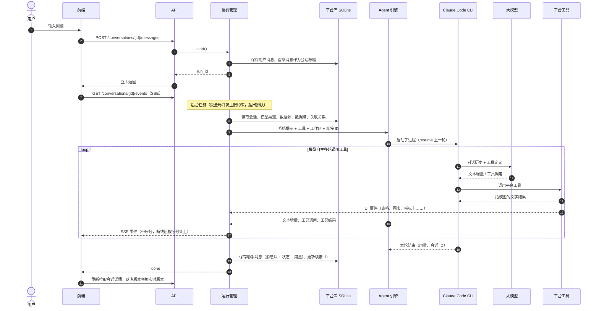
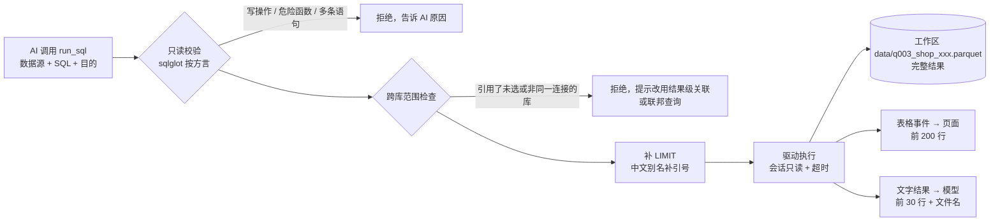
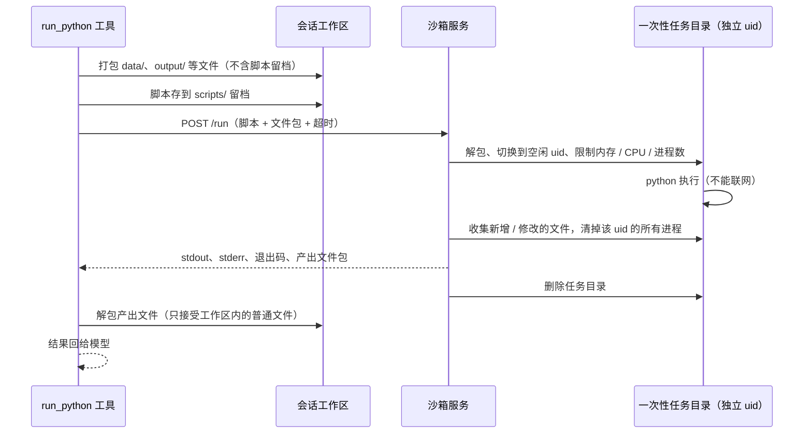
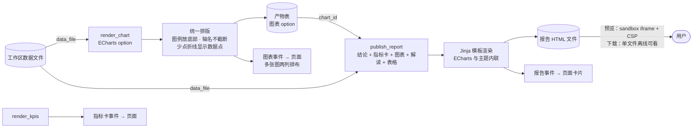
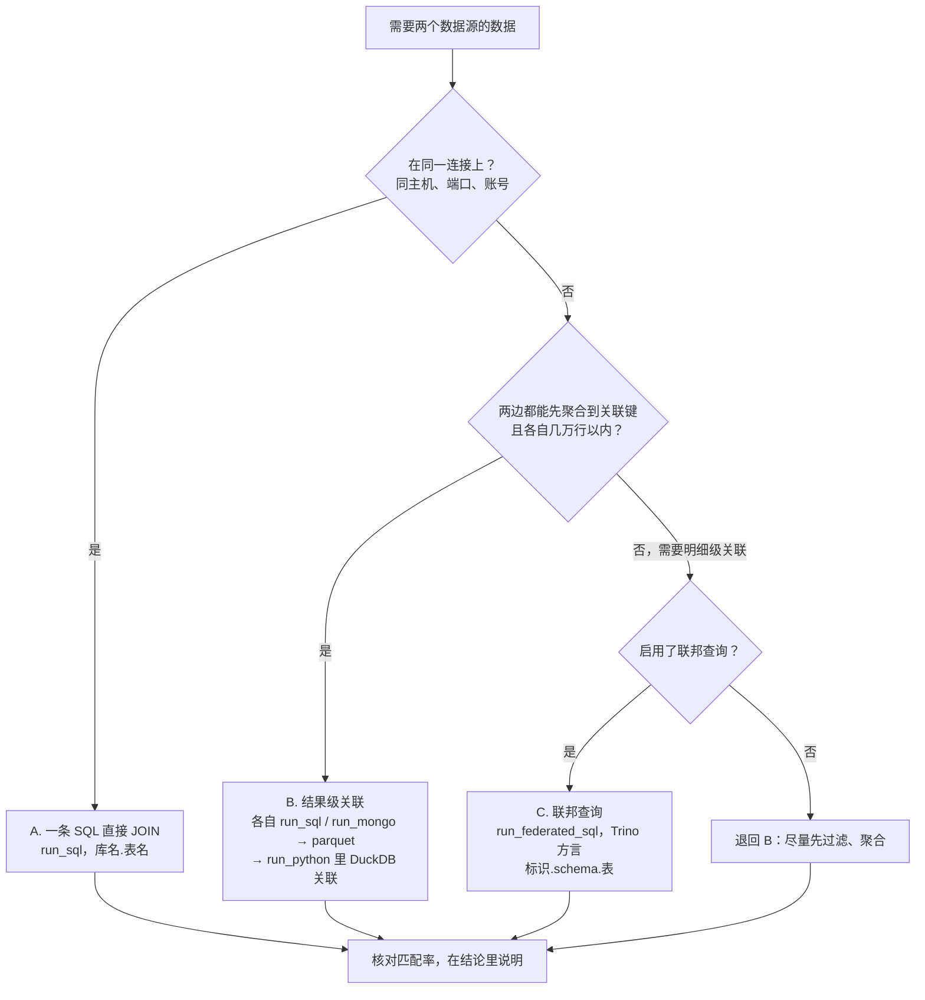
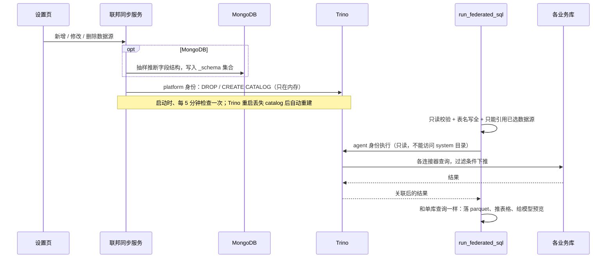
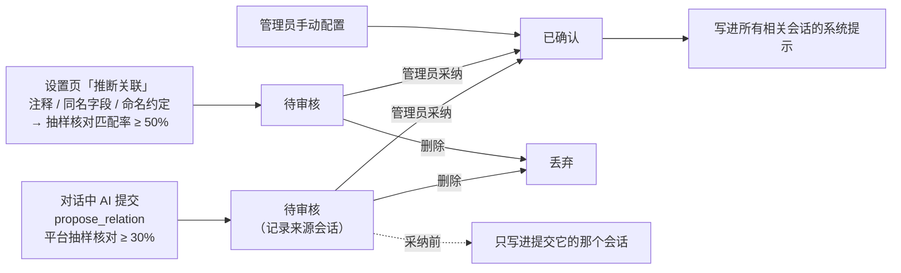
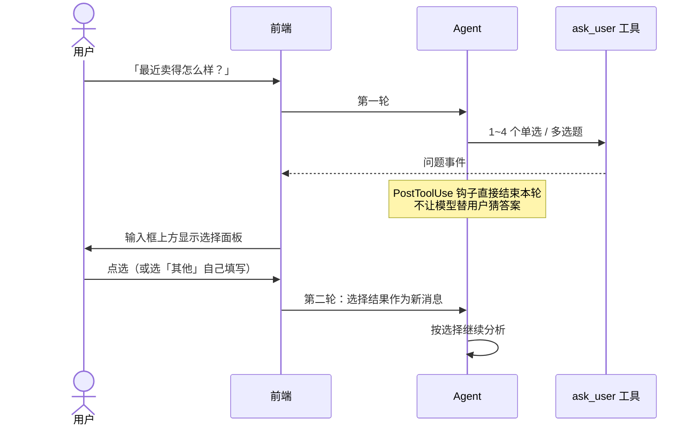

# 数据流向

本文按「一个问题从提出到得出结论」的顺序，说明数据在系统里怎么流动。

## 1. 一轮对话的全过程

要点：

- **运行与连接解耦**：分析在后台任务里跑，页面刷新、断网都不影响；重新打开会话时按事件序号重放、接着看
- **事件统一成消息块**：引擎和工具发出的事件，前端实时渲染、后端落库，用的是同一套规则（`runs/blocks.py` ↔ `frontend/src/lib/blocks.ts`）
- **停止生成**：前端调 `/stop` → 引擎向 CLI 发中断 → 已经执行的步骤保留，状态记为「已停止」

## 2. 取数：从数据库到结果文件

- 完整结果只落文件，模型只看 30 行预览：省 token，也避免大表把对话撑爆
- 后续的 Python、图表、报告都直接读这些 parquet 文件
- MongoDB 走 `run_mongo`，同样的流程；结果先拍平（嵌套字段变成 `a.b` 列）再落文件

## 3. Python 计算：工作区 ⇄ 沙箱

## 4. 图表、指标卡与报告

聊天里的图表、报告里的图表、前端的主题，用的是同一份 ECharts 主题（`report/theme.py`，前端经 `/api/chart-theme` 获取）。

## 5. 跨数据源关联的三条路径

### 联邦查询的数据流

## 6. 关联关系的来源与生命周期

推断时会去掉噪音：同一数据源内部的外键不进审核队列；两端已经能通过已知关系连通的「兄弟字段」（比如都指向订单号的两个字段）不重复提。

## 7. 引导式提问

## 8. 数据存放与清理

| 数据 | 位置 | 生命周期 |
|---|---|---|
| 配置、会话、消息、关联、表结构缓存 | `app-data` 卷 `/data/app.db` | 长期保存 |
| 模型渠道 API Key、数据源密码 | 同上，Fernet 加密 | 长期保存；`DA_SECRET_KEY` 变了就解不开 |
| Claude 对话记录（续接用） | `/data/claude/projects/…` | 随会话删除 |
| HTML 报告 | `/data/artifacts/<会话>/` | 随会话删除 |
| 查询结果、脚本、脚本产出 | `workspaces` 卷 `/workspaces/<会话>/` | 会话超过 30 天没有新消息自动清理（对话与报告保留）；随会话删除 |
| 沙箱任务目录 | sandbox 容器 tmpfs | 每次执行结束即删除 |
| Trino catalog | Trino 内存 | Trino 重启即丢，平台自动重建 |

后台每小时清理一次：过期工作区，以及数据库里已经没有对应会话的孤儿目录（只清理一小时以上没变动的，避免误删刚建好的会话）。
